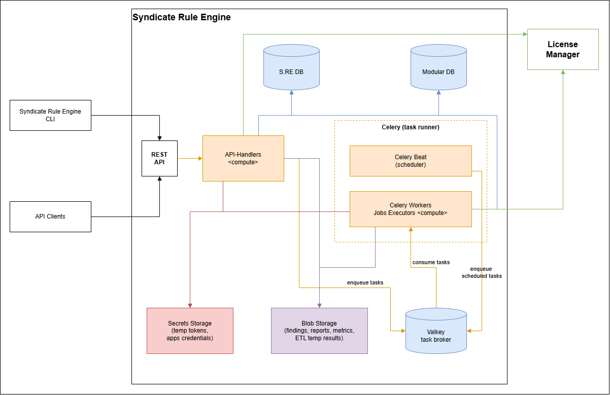
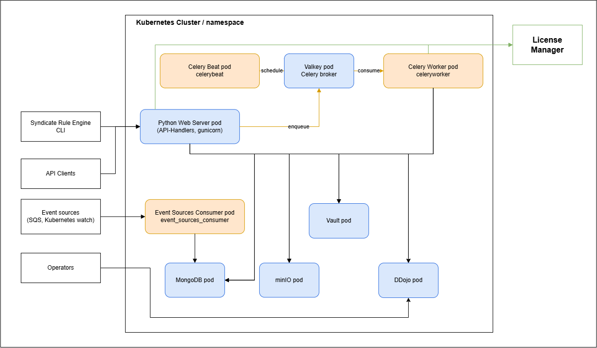
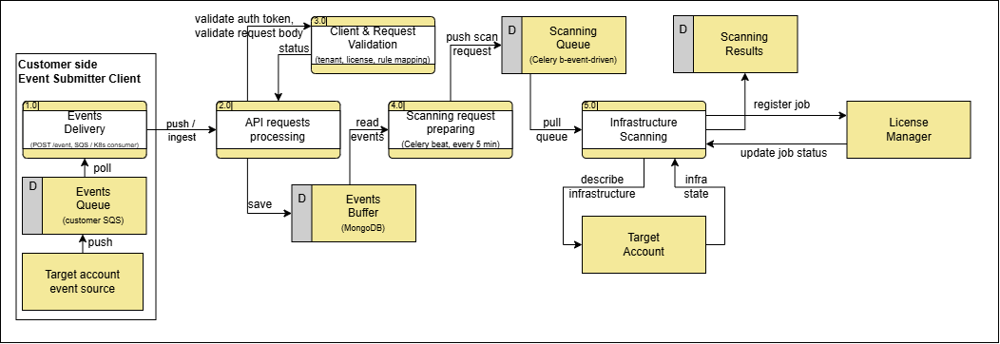

# Introduction

The EPAM Syndicate Rule Engine (also S.RE) is a solution that allows checking and assessing virtual infrastructures in AWS, Microsoft Azure, GCP clouds and Kubernetes clusters against legal, industry, corporate and customer requirements, standards, and best practices rulesets. By default, the solution provides hundreds of security, compliance, utilization, and cost effectiveness rules, which allow users to make sure that their infrastructures match world-known standards like GDPR, PCI DSS, CIS Benchmark, and more.

This allows an enterprise to be sure that the environments used for production or development purposes are compliant with the various rules. Meanwhile, it minimizes the challenges like finding proper tools, performing checks in different directions, analyzing findings and quickly reacting, proper remediation planning, ensuring continuous compliance, and maintaining the cost effectiveness and optimization of infrastructure.

For existing businesses, it helps inventory and assessment for their legacy infrastructure and planned updates. For new businesses, it can help make sure their processes and infrastructure match standards and are effective and safe.

{{ pagebreak }}

## Table of Contents

1. [Introduction](#introduction)
2. [EPAM Syndicate Rule Engine Deployment](#epam-syndicate-rule-engine-deployment)
   - [Pre-Requisites](#pre-requisites)
   - [Required Permissions](#required-permissions)
   - [Components Overview](#components-overview)
   - [Deployed Environment Configuration and Resources](#deployed-environment-configuration-and-resources)
3. [EPAM Syndicate Rule Engine Configuration](#epam-syndicate-rule-engine-configuration)
   - [Initial AMI Instance Launch](#initial-ami-instance-launch)
   - [Initializing AMI for another Linux User](#initializing-ami-for-another-linux-user)
   - [User Registration](#user-registration)
   - [Activating Tenants](#activating-tenants)
   - [License Management](#license-management)
4. [Product Maintenance and Support](#product-maintenance-and-support)
   - [Product Health Check](#product-health-check)
   - [Product Troubleshooting](#product-troubleshooting)
   - [Backup & Recovery](#backup--recovery)
   - [Upgrades and Patches](#upgrades-and-patches)
5. [Security Highlights](#security-highlights)
   - [Rotating Keys & Credentials](#rotating-keys--credentials)
   - [Policies and Privileges](#policies-and-privileges)
   - [Data Encryption](#data-encryption)
6. [Scanning and Reporting](#scanning-and-reporting)
   - [Quick Start](#quick-start)
   - [Requesting a Full Scan](#requesting-a-full-scan)
   - [Requesting Scan by Specific Rules](#requesting-scan-by-specific-rules)
   - [Disabling Rules for a Tenant](#disabling-rules-for-a-tenant)
   - [Scanning Kubernetes Clusters](#scanning-kubernetes-clusters)
   - [Scheduled Jobs](#scheduled-jobs)
   - [Event-Driven Scanning](#event-driven-scanning)
   - [Receiving Reports](#receiving-reports)
   - [Integrations](#integrations)
7. [Support](#support)
8. [Annexes](#annexes)
   - [Annex 1: Secrets Inside AMI](#annex-1-secrets-inside-ami)
   - [Annex 2: Permissions](#annex-2-permissions)
   - [Annex 3: License Pricing](#annex-3-license-pricing)

{{ pagebreak }}

## Use Case Examples

Below, you can find a list of real-life use cases for the product that illustrate the range of its possibilities:

### Standard Compliance Check

**Problem Statement:**  
An enterprise needs to ensure continuous compliance of their virtual infrastructure with the most referenced security standards.

**Solution:**  
Establishing scheduled security checks on AWS, Azure, and GCP environments using EPAM Syndicate Rule Engine and building analytic reports atop the findings. Remediation rules and SLAs additionally defined in the corporate policies.

**Result:**  
The approach to security assessment across the enterprise virtual resources is unified. The vulnerabilities remediation process becomes faster and more effective.

### FinOps Optimization

**Problem Statement:**  
An enterprise needs to make the FinOps processes more effective and transparent.

**Solution:**  
Activating FinOps checks to see the expenses trends and costs control best practices violations.

**Result:**  
Improved reaction to anomalies and targeted issues remediation allowed for a quick response on the overall enterprise cost.

### Pre-Production Assessment

**Problem Statement:**  
A new company needs to assess the infrastructure against typical standards before going to production.

**Solution:**  
A one-time scan set up on all environments to verify the overall readiness to production. A scheduled scan was set to re-assess the infrastructure based on the updates schedule.

**Result:**  
The initial scan detected a set of critical issues that were fixed timely without exposing the enterprise to major threats. Regular check-ups allow keeping to the desired level of compliance in a unified and transparent way.

[Go to Table of Contents](#table-of-contents)

{{ pagebreak }}

# EPAM Syndicate Rule Engine Deployment

The product is deployed as an AMI provisioned:

- Per request on [EPAM Solutions Hub](https://solutionshub.epam.com/solution/syndicate-rule-engine)
- As an offering on [AWS Marketplace](https://aws.amazon.com/marketplace/pp/prodview-ps7o6zmsvha6m?applicationId=AWSMPContessa&ref_=beagle&sr=0-2)

Once you obtain the AMI, you need to launch an instance from it and start the product.

> **Note:** The deployment with AMI and necessary post-configuration typically takes up to 30 minutes.

Other deployment options, which are not covered by this guide:

- **Kubernetes (Helm)** -- the Helm chart in `deployment/helm` for custom installations
- **Docker Compose** -- `deployment/compose`, intended for evaluation and development only

## Pre-Requisites

The deployment pre-requisites include technical and skill-based ones.

### Technical Pre-Requisites

- Having an AWS account
- Having permissions enough to run new EC2 instances

> **Note:** No other deployment prerequisites are to be met, as the offering is delivered via an AMI.

### User Skills Requirements

To set up EPAM Syndicate Rule Engine and work with it effectively, you need to:

- Have basic EC2 knowledge -- to run an AWS AMI image
- Have Unix/Linux command line knowledge -- to run the configuration script

## Required Permissions

EPAM Syndicate Rule Engine requires a set of permissions to perform checks on Cloud accounts.

The necessary permissions are listed in the following repositories:

- **AWS:** <https://github.com/epam/ecc-aws-rulepack/tree/main/iam>
- **Azure:** <https://github.com/epam/ecc-azure-rulepack/tree/main/iam>
- **Google Cloud:** <https://github.com/epam/ecc-gcp-rulepack/blob/main/iam/iam.tf>

{{ pagebreak }}

## Components Overview

The Architecture diagram below provides the view on the main components of the offering, provisioned within the AMI.

### Reference Diagram



```{=openxml}
<w:p><w:pPr><w:pStyle w:val="ImageCaption"/><w:jc w:val="center"/></w:pPr><w:r><w:t>Figure 1 - Reference Diagram</w:t></w:r></w:p>
```

### Containers Diagram using AMI on EC2



```{=openxml}
<w:p><w:pPr><w:pStyle w:val="ImageCaption"/><w:jc w:val="center"/></w:pPr><w:r><w:t>Figure 2 - Containers Diagram</w:t></w:r></w:p>
```

{{ pagebreak }}

## Deployed Environment Configuration and Resources

During the product deployment, a set of AWS and System resources are created.

### AWS Resources

The AMI-based deployment relies on an instance with the following minimum configuration:

- **OS:** Ubuntu (Canonical, Ubuntu, 22.04 LTS, amd64 jammy image)
- **vCPU:** 2
- **RAM:** 8 GB
- **Disk:** 30 GB, at least GP3 3000 IOPS

> **Note:** The provisioned AMI is available across all AWS regions. These parameters can be used for estimating cost of the solution in a specific deployment region.

### System Resources

During the deployment, several secrets are generated. They are stored as Kubernetes secrets inside the Minikube cluster and can be read only by the instance administrator.

> **Tip:** The list of these secrets and the way to read them is given in [Annex 1: Secrets Inside AMI](#annex-1-secrets-inside-ami).

### Customer Sensitive Data

- Customer's secrets if they exist are stored inside Vault. Vault has a persistent volume attached.
- Customer's scans results data is stored inside Minio bucket `custodian-reports`.

[Go to Table of Contents](#table-of-contents)

{{ pagebreak }}

# EPAM Syndicate Rule Engine Configuration

After an instance with the EPAM Syndicate Rule Engine is deployed from the provisioned AMI, several steps are to be made to complete the configuration:

- [Initial AMI Instance Launch](#initial-ami-instance-launch) -- the basic login and S.RE start
- [Initializing AMI for another Linux User](#initializing-ami-for-another-linux-user) -- enabling the S.RE for a new Linux user
- [User Registration](#user-registration) -- registering a new user to enable S.RE performance
- [Activating Tenants](#activating-tenants) -- registering tenants (cloud accounts) for compliance checks
- [License Management](#license-management) -- managing licenses and rule-sets

## Initial AMI Instance Launch

When AMI is launched and its instance status check is green, you can log in to the instance via SSH and use EPAM Syndicate Rule Engine immediately from the syndicate CLI entry point.

There are two groups of commands:

- **`syndicate re ...`** -- used to access scanning and reporting API (*re* stands for "rule engine")
- **`syndicate admin ...`** -- used to manage logical entities that represent accounts and organizations (admin - entities administrator)

The AMI also has a script called **`sre-init`** that manages the installation. Its main subcommands are:

| **Command** | **Description** |
|-------------|-----------------|
| `sre-init init` | Initializes S.RE for a Linux user |
| `sre-init secrets [name]` | Lists or prints the generated secrets |
| `sre-init backup create / restore` | Creates and restores backups |
| `sre-init list` | Lists available releases |
| `sre-init update` | Updates the installation |
| `sre-init health` | Checks the installation |
| `sre-init doctor` | Diagnoses the instance |
| `sre-init version` | Shows the installed version |

Run `sre-init --help` for the full list.

## Initializing AMI for another Linux User

The `sre-init init` command initializes EPAM Syndicate Rule Engine for a new Linux user. By default, only the first non-root Linux user has SRE installed.

If you want to initialize the S.RE for other Linux users, execute the command:

```console
sre-init init --user "username" --public-ssh-key "ssh-..." --re-username job_submitter --re-password $SECRET_PASSWORD
```

A user with name **username** will be created if it does not exist yet. If **`--public-ssh-key`** is specified, it will be added to `~/.ssh/authorized_keys` of that user. You can also provide **`--re-username`** & **`--re-password`** of an S.RE user created before to set these credentials.

## User Registration

A user is needed for the EPAM Syndicate Rule Engine to perform. Before creating one, it is necessary to create a separate policy and role for them.

### Steps

**1. Create a policy:**

```console
syndicate re policy add --name run_scan_for_all_tenants --permission "job:post_for_tenant" --effect allow --description "Allows to submit jobs for all tenants"
```

> **Note:** The list of all permissions can be found in [Annex 2: Permissions](#annex-2-permissions).

**2. Create a role:**

```console
syndicate re role add --name run_scans_role --policies run_scan_for_all_tenants --description "Allows only to submit jobs"
```

**3. Create a user:**

```console
syndicate re users create --username job_submitter --password $SECRET_PASSWORD --role_name run_scans_role
```

**4. Log in as the newly created user** or give its credentials to someone else:

```console
syndicate re login --username job_submitter --password $SECRET_PASSWORD
syndicate re job describe
```

### Managing Policies and Roles

**Policies can be added and removed** from roles with the following command:

```console
syndicate re role update --name run_scans_role --attach_policy admin_policy --detach_policy run_scan_for_all_tenants
```

## Activating Tenants

A tenant is a main entity that EPAM Syndicate Rule Engine manages and requires. One tenant represents one AWS Account or Azure subscription or Google project that is to be scanned. If you want to scan something, you must create a tenant that represents it.

When an instance is launched from AMI, one tenant is created automatically. Its default name is `TENANT_1` (or the AWS account alias in upper case, if the account has one; it can be set with the `TenantName` parameter of the CloudFormation template) and it represents the AWS account where the AMI was launched. This tenant has one active region (the one where instance is launched). In case the instance profile allowed READ access to the AWS account, that tenant can be immediately used.

### Activating Tenants linked to cloud accounts

If you want to scan an account other than the one where the EPAM Syndicate Rule Engine instance is launched, you must do the following configuration steps:

**1. Create a tenant entity that represents the account you want to scan:**

```console
syndicate admin tenant create \
  --name "MY_OTHER_ACCOUNT" \
  --display_name "Dev account" \
  --cloud AWS \
  --account_id 111111111111 \
  --primary_contacts admin@example.com \
  --secondary_contacts admin@example.com \
  --tenant_manager_contacts admin@example.com \
  --default_owner admin@example.com
```

**2. Activate necessary regions for the tenant:**

```console
syndicate admin tenant regions activate --tenant_name MY_OTHER_ACCOUNT --region_name eu-west-1
syndicate admin tenant regions activate --tenant_name MY_OTHER_ACCOUNT --region_name eu-central-1
```

**3. Configure AWS access keys or access role for that specific tenant.**

> **Note:** Access keys can be provided individually for each scan which is definitely the case, but it's somewhat inconvenient:

```console
syndicate admin application create_aws_credentials \
  --access_key $AWS_ACCESS_KEY_ID \
  --secret_key $AWS_SECRET_ACCESS_KEY \
  --session_token $AWS_SESSION_TOKEN \
  --description "Temporary credentials"
```

You can configure an AWS role or, for instance, Azure Certificate to be used for scanning multiple times. To do this, you must create a so-called Application entity and then bind it to some tenants. Let's take a look at an AWS Role example:

```console
syndicate admin application create_aws_role \
  --role_name rule-engine-scanner \
  --account_id 111111111111 \
  --description "Generic role for AWS tenants"
```

**4. Link the application to ALL the tenants:**

```console
syndicate re tenant credentials link --application_id <application_id_received_from_command_above> --all_tenants
```

Now, if you submit a scan for any tenant within the customer, S.RE will try to use that `rule-engine-scanner` AWS Role. Account ID is generic so `111111111111` is just the default value. Tenant's account ID will be used dynamically, i.e. `arn:aws:iam::123123123123:role/rule-engine-scanner` for tenant with account id `123123123123` and so on. The same way one Application with Azure Certificate can be linked to multiple Azure tenants (remember, one tenant is one subscription).

### Creating API Users

When the AMI is launched, Admin users are created for the EPAM Syndicate Rule Engine and for the Modular Service. They are configured by default. Their passwords can be read with:

```console
sre-init secrets rule-engine-admin-password
sre-init secrets modular-service-admin-password
```

> **Note:** All the sensitive information is listed in [Annex 1: Secrets Inside AMI](#annex-1-secrets-inside-ami). Username **`admin`** is default for both.

Your admin S.RE user has rights to manage other users inside your customer:

```console
syndicate re users describe
```

Each user has an assigned role. Each role can have multiple policies attached. Each policy can allow or deny specific actions over API, so you can flexibly configure access to the system.

## License Management

A license is a logical entity that issues rule-sets for scanning.

Each customer can have a license assigned to it and therefore a unique list of allowed rulesets. Licenses are issued by EPAM Syndicate License Manager.

Each AMI-based instance will have a single license which can give multiple rule-sets. You can add more licenses to the installation if you have license keys. Those can be issued by the Syndicate License Manager team.

### Adding a License

Let's assume you have a license key and want to add it to the installation.

**1. Add a license:**

```console
syndicate re license add --tenant_license_key $TENANT_LICENSE_KEY --description "my newly provided license"
```

**2. Activate the license for tenants.** You must do that because you can have overlap (two different licenses can issue different rulesets for the same tenant):

```console
syndicate re license activate \
  --license_key <License_key_from_previous_command> \
  --tenant_name TENANT_1 \
  --tenant_name ANOTHER_ACCOUNT
```

> **Note:** License Key from the previous command is not the same as `$TENANT_LICENSE_KEY`.

To prolong, update, or cancel an existing license, please contact the support team.

> **Tip:** The overview of available plans and prices are given in [Annex 3: License Pricing](#annex-3-license-pricing).

[Go to Table of Contents](#table-of-contents)

{{ pagebreak }}

# Product Maintenance and Support

EPAM Syndicate Rule Engine includes a set of tools, checks and services that enable effective maintenance and support:

- [Product Health Check](#product-health-check) -- the check of the main components status
- [Product Troubleshooting](#product-troubleshooting) -- the fixes for the typical possible issues
- [Backup & Recovery](#backup--recovery) -- the recommendations on the backup and recovery approaches
- [Upgrades and Patches](#upgrades-and-patches) -- the processes of the product updates and patches deployment

## Product Health Check

EPAM Syndicate Rule Engine has its health check. It makes sure that:

- Minio is available
- Mongo is available
- Vault is available
- Necessary buckets exist in Minio
- License Manager private key is configured
- License Manager API link is configured
- System customer setting configured
- S.RE secret key exists in Vault
- RabbitMQ connection works (only if RabbitMQ is configured for the customer)

To perform the health check procedure, run:

```console
syndicate re health_check
```

## Product Troubleshooting

The health check procedure can return several statuses that need your attention.

### Status: NOT_OK

**Action:** Contact the support team.

### Status: Job has finished with status FAILED

**Action:** Describe the job using the command below and look at the `reason` field.

```console
syndicate re job describe --job_id $JOB_ID
```

The `reason` can be one of these:

#### License manager does not allow this job

Your license has expired or the limit of jobs is exceeded or license manager is temporarily unavailable. Try to submit the job again in a while and if it does not help - contact the support team.

#### Could not resolve any credentials

The executor cannot find cloud credentials to use during the scan. In case you are going to scan the same account where the instance is running, you can create an EC2 Instance profile role and attach it to the instance. If you are going to scan another account, you can provide temp credentials to CLI commands:

```console
syndicate re job scan aws ... \
  --access_key_id $AWS_ACCESS_KEY_ID \
  --secret_access_key $AWS_SECRET_ACCESS_KEY \
  --session_token $AWS_SESSION_TOKEN
```

> **Tip:** Also, you can configure AWS role, etc. using `syndicate admin` commands.

#### All policies failed

Every rule of the job failed with the same error type, which is shown in the `reason`. Most often it is an access problem: check the credentials and the permissions of the role used for the scan (see [Required Permissions](#required-permissions)).

#### Internal executor error

The executor failed with internal reason. Contact the support team.

### Status: Cannot submit job

If the `syndicate re job scan` command returns:

#### Tenant could not be granted to start a licensed job with tenant license

Our license manager does not allow submitting the license. Either your jobs limit per period was exceeded or LM is temporarily unavailable. Try again in a while.

#### There are no linked licenses for this tenant

Your license is probably expired or invalid and was removed when license synchronization happened. Contact the support team.

#### No appropriate licensed rulesets found for the requested scan

Try not specifying `--ruleset` for `syndicate re job scan`. Or specify the valid ruleset name, retrieved from `syndicate re ruleset describe`.

### Status: Cannot execute any command because token has expired

If `syndicate ...` any command returns **"The provided token has expired. Please re-login to get a new token"**, try the following:

```console
syndicate login
```

## Backup & Recovery

The main backup strategy for the product is using an AMI Snapshot. You can either use the initial AMI provisioned for the product deployment, or create a custom snapshot using standard AWS tools.

Also, the `sre-init` script can back up the persistent volumes of the cluster:

```console
sre-init backup create --name my-backup --volumes=minio,mongo,vault
sre-init backup ls
sre-init backup restore --name my-backup
```

The available volumes are `minio`, `mongo`, `vault`, `defectdojo-cache`, `defectdojo-data` and `defectdojo-media` (the last three exist only if DefectDojo is installed). Run `sre-init backup --help` for the full list of options.

For tenant data export, it is recommended to arrange backup to an external storage.

## Upgrades and Patches

The upgrades and patches for the product are delivered within updated AMIs and changes on GitHub.

The components upgrade and patches application logic is in-built into the solution. The upgrade is incremental: it is possible to update only through each successive version, skipping intermediate versions is not supported. To initiate components update and data patching, you need to authenticate to the host instance using SSH and admin user and execute the following commands:

```console
sre-init list            # shows available releases, the installed one is marked with *
sre-init update --check  # checks whether an update is available
sre-init update          # updates the installation
```

A backup is created automatically before the update (it can be disabled with `--no-backup`).

> **Note:** The update can take from several minutes up to one hour, depending on the amount of changes and data. The process needs service downtime.

[Go to Table of Contents](#table-of-contents)

{{ pagebreak }}

# Security Highlights

EPAM Syndicate Rule Engine security includes the following keystone approaches:

- [Rotating Keys & Credentials](#rotating-keys--credentials)
- [Policies and Privileges](#policies-and-privileges)
- [Data Encryption](#data-encryption)

Below, the details on each part are given.

## Rotating Keys & Credentials

The following tools and approaches are applied for keys rotation within the solution:

### Rotate your S.RE user's password

```console
syndicate re whoami # returns the current user. You should be logged in.
syndicate re users change_password --password $NEW_PASSWORD
syndicate re login --username $USERNAME --password $NEW_PASSWORD
```

### Rotate your Modular Service user's password

```console
syndicate admin users change_password --password $NEW_PASSWORD
syndicate admin login --username $USERNAME --password $NEW_PASSWORD
```

### Rotate your Modular API password (experimental, only for `sudo` user)

```console
kubectl exec deployment/modular-api -- python modular.py user change_password --username $MODULAR_API_USER --password $NEW_PASSWORD
syndicate setup --username $MODULAR_API_USER --password $NEW_PASSWORD --api_path http://127.0.0.1:8085 # re-login
```

### Automatically Generated Keys

**The keys for the following components are automatically generated** at the service start, and stored inside the cluster, preserving the security of the OS users access:

- Vault, Mongo, Minio credentials
- Defect Dojo credentials and secret keys
- S.RE Secret keys

> **Note:** The generated keys are stored as Kubernetes secrets, see [Annex 1: Secrets Inside AMI](#annex-1-secrets-inside-ami).

## Policies and Privileges

The following approaches for policies and privileges on your AWS account are highly recommended to ensure the infrastructure security:

- The product does not need AWS root account privileges
- Do not use AWS account root user for any deployment or operations
- The principle of least privilege is an option of choice when it comes to access granted within the deployment

> **Note:** EPAM Syndicate Rule Engine needs extended FULL READ ONLY access to AWS Services in order to perform scanning. Do not use AWS-managed [ReadOnlyAccess IAM policy](https://docs.aws.amazon.com/aws-managed-policy/latest/reference/ReadOnlyAccess.html), as it is not sufficient to complete the scan.

- There are no public resources except the License Manager and accounts that are to be scanned
- Instance metadata V2 is used during setup to retrieve instance identity document and its signature

## Data Encryption

EPAM Syndicate Rule Engine follows these encryption approaches:

- All communication between the cluster components (pods) is NOT encrypted (http)
- Communication with the S.RE License Manager is encrypted
- There is no persistent encryption for Minio and Mongo
- Vault is sealed when the instance is stopped and unsealed when it's started

[Go to Table of Contents](#table-of-contents)

{{ pagebreak }}

# Scanning and Reporting

The main tool for EPAM Syndicate Rule Engine usage is the CLI.

Further in this section, you can find the instructions on specific actions that can be performed with the tool:

- [Quick Start](#quick-start) -- basic steps to perform your first scans
- [Requesting a Full Scan](#requesting-a-full-scan) -- requesting a scan for all available regions and rulesets
- [Requesting Scan by Specific Rules](#requesting-scan-by-specific-rules) -- requesting a scan by specific rules available within the S.RE
- [Disabling Rules for a Tenant](#disabling-rules-for-a-tenant) -- setting exclusions for the rules within a tenant
- [Scanning Kubernetes Clusters](#scanning-kubernetes-clusters) -- registering K8S platforms and scanning them
- [Scheduled Jobs](#scheduled-jobs) -- running scans on a schedule
- [Event-Driven Scanning](#event-driven-scanning) -- reacting to cloud and cluster events
- [Receiving Reports](#receiving-reports) -- getting the results of the performed scans
- [Integrations](#integrations) -- pushing results to DefectDojo and Chronicle

## Quick Start

When the AMI instance is running, you **can log in using SSH and immediately use EPAM Syndicate Rule Engine**.

```console
ssh -i "private-key.pem" admin@domain.compute.amazonaws.com
syndicate version
```

**Syndicate** is the main CLI entry point that you should use to interact with S.RE API and Modular Service API. S.RE API allows you to execute scans and receive reports. Modular Service is an admin API. It allows you to configure such organization entities as Customers and Tenants. Use commands `syndicate re` and `syndicate admin` accordingly.

### Authentication

Both S.RE API and Modular Service API have authentication mechanisms and credentials to access them. Those were set for you during setup and their refresh tokens are updated automatically when the session ends. The syndicate tool also has its authentication mechanism, and it may require you to log in once in a while.

If any **syndicate ... command tells that the session has ended, use this command**:

```console
syndicate login
```

> **Note:** Credentials are stored here: `~/.modular_cli/`

### Available Entities and Resources

From the beginning, the only entity that represents the AWS account where the instance is running is activated. Such entities are called Tenants.

**Describe tenants** using this command:

```console
syndicate re tenant describe
```

> **Note:** This one by default has `TENANT_1` name that must be used to reference this entity.

When the instance was starting, it made a request to our License Manager and received a license and rule-sets.

**Describe the license** using this command:

```console
syndicate re license describe
```

**Describe available rulesets**:

```console
syndicate re ruleset describe
```

**Describe available rules**:

```console
syndicate re ruleset describe --get_rules
```

### Executing Scans

If the instance has an Instance Role with access to this AWS Account, you can **execute scans immediately** without further configuration. Use this command:

```console
syndicate re job scan aws --tenant_name TENANT_1 --region eu-west-1 # or the region you want
```

S.RE will use rulesets that are available by license and credentials from the instance profile.

> **Note:** Use `job scan aws`, `job scan azure`, `job scan gcp` or `job scan k8s` depending on the cloud.

**To see the job status**, use:

```console
syndicate re job describe --limit 1
```

### Retrieving Reports

When the status is `SUCCEEDED`, you can **request some reports**:

```console
syndicate re report digests jobs --job_id <job_id> --json
syndicate re report resource latest --tenant_name TENANT_1 --json > data.json
```

> **Tip:** See the full documentation for further details.

## Requesting a Full Scan

To **request a scan** for a `TENANT_1` tenant for all regions and all rules, run the following command:

```console
syndicate re job scan aws --tenant_name TENANT_1 --region eu-west-1
```

To **see the status of the submitted job**, use the describe command:

```console
syndicate re job describe --job_id <job_id_from_submit_command>
```

## Requesting Scan by Specific Rules

You can use rule-sets names to scan only those in case the license provides multiple rulesets for one cloud.

**To find available rule sets**, run:

```console
syndicate re ruleset describe
```

**To find available rules**:

```console
syndicate re ruleset describe --get_rules
```

**To start the scan**:

```console
syndicate re job scan aws --tenant_name TENANT_1 --ruleset FULL_AWS --region eu-west-1
```

Also, you can restrict the scope to specific rule names:

```console
syndicate re job scan aws \
  --tenant_name TENANT_1 \
  --ruleset FULL_AWS \
  --rules_to_scan ecc-aws-001... \
  --rules_to_scan ecc-aws-002...
```

> **Note:** List of all rules and their descriptions can be found in product repositories:
> - **AWS:** <https://github.com/epam/ecc-aws-rulepack/tree/main/iam>
> - **Azure:** <https://github.com/epam/ecc-azure-rulepack/tree/main/iam>
> - **Google Cloud:** <https://github.com/epam/ecc-gcp-rulepack/blob/main/iam/iam.tf>

## Disabling Rules for a Tenant

You can exclude some rules for a specific tenant or for the whole customer if you know that you won't need those although the ruleset has them.

**To find available rules**:

```console
syndicate re ruleset describe --get_rules
```

**Exclude for tenant**:

```console
syndicate re tenant set_excluded_rules \
  --tenant_name TENANT_1 \
  --rules ecc-aws-001 \
  --rules ecc-aws-002
```

**Exclude for customer:**

```console
syndicate re customer set_excluded_rules --rules ecc-aws-003
```

## Scanning Kubernetes Clusters

Kubernetes clusters are scanned as **platforms**. A platform is bound to a tenant, which is used for licensing and reporting.

**Register a platform:**

```console
syndicate re platform k8s create \
  --tenant_name TENANT_1 \
  --name my-cluster \
  --type EKS \
  --region eu-west-1 \
  --description "Production cluster" \
  --endpoint https://<cluster-api-endpoint> \
  --certificate_authority $BASE64_CA \
  --token $LONG_LIVED_TOKEN
```

The cluster type can be `SELF_MANAGED`, `EKS`, `AKS` or `GKS`. If `--certificate_authority` is not given, TLS verification is skipped (it can also be forced with `--insecure_skip_tls_verify`).

**List platforms and start a scan:**

```console
syndicate re platform k8s describe
syndicate re job scan k8s --platform_id <platform_id> --ruleset <k8s_ruleset>
```

The inventory of each registered platform is collected together with the resources of the tenants. It can be requested with:

```console
syndicate re resource describe_platform --platform_id <platform_id>
syndicate re report resource platform_latest --platform_id <platform_id> --json
```

Platforms can also be scanned on events, see [Event-Driven Scanning](#event-driven-scanning).

## Scheduled Jobs

A scan can be repeated automatically. The schedule is either a cron expression or a rate:

```console
syndicate re job scheduled add \
  --tenant_name TENANT_1 \
  --schedule "cron(0 20 * * *)" \
  --ruleset FULL_AWS \
  --region eu-west-1 \
  --description "Every day at 20:00 UTC"

syndicate re job scheduled describe
syndicate re job scheduled update --name <name> --schedule "rate(12 hours)" --enabled false
syndicate re job scheduled delete --name <name> --confirm
```

If `--name` is not given, it is generated automatically.

## Event-Driven Scanning

Besides full scans, S.RE can react to events that happen in the cloud or in a Kubernetes cluster. Instead of scanning everything, it runs only the rules that are related to the event (for example, rules for EC2 instances when `RunInstances` was called). Such jobs have the type `reactive`.

### How It Works



```{=openxml}
<w:p><w:pPr><w:pStyle w:val="ImageCaption"/><w:jc w:val="center"/></w:pPr><w:r><w:t>Figure 3 - Event-driven flow</w:t></w:r></w:p>
```

1. **Ingest.** Events are received by `POST /event` (permission `event:post`) or pulled by the *event sources consumer* (from SQS queues and from Kubernetes clusters). Each event is resolved to a tenant. The event is dropped if the tenant is not found, if the tenant has no active license with event-driven scans enabled, or if none of the rules of the license is related to the event (the event-to-rule mapping is built from the license metadata during the license synchronization). Duplicate events are removed.
2. **Store.** Accepted events are saved and kept for `SRE_EVENTS_TTL_HOURS` hours (48 by default).
3. **Assemble.** A periodic task (`assemble-events`, every 5 minutes by default) takes all events that arrived since its previous run and creates one job per tenant (per platform for Kubernetes). The job scans the union of the rules related to the events, limited to the rulesets of the license that match the cloud. For AWS the job is executed for the regions of the events; for Azure, Google and Kubernetes the whole tenant or platform is scanned.
4. **Cleanup.** A daily task (`clear-events`) removes the events that have already been assembled.

The result is a regular job that can be seen with `syndicate re job describe` and whose reports are available as for any other job.

### Prerequisites

- A license with event-driven scans enabled is activated for the tenant (see [License Management](#license-management)) and the license has been synchronized, so the event mapping is available. If the mapping is missing, the ingest log contains the warning `metadata is not synced for this license key`
- The tenant is active. For AWS the account ID of the event must belong to an active tenant
- For Kubernetes, the platform is registered and event-driven scanning is enabled for it:

```console
syndicate re platform k8s update --platform_id <platform_id> --event_driven_enabled true
```

New platforms have it disabled by default.

### Supported Events

| **Cloud** | **Vendor** | **Tenant is resolved by** | **Scope of the job** |
|-----------|------------|---------------------------|----------------------|
| AWS | `AWS` (EventBridge / CloudTrail), or `MAESTRO` with `cloud = AWS` | `userIdentity.accountId` (`AWS`) or `tenantName` (`MAESTRO`) | The region of the event |
| Azure | `MAESTRO` | `tenantName` | The whole tenant |
| Google | `MAESTRO` | `tenantName` | The whole tenant |
| Kubernetes | `SRE_K8S_AGENT`, `SRE_K8S_WATCHER` | `platformId` (the platform must be registered) | The platform |

### Request Format

Events are sent to `POST /event` with the following wrapper:

```json
{
  "version": "1.0.0",
  "vendor": "AWS | MAESTRO | SRE_K8S_AGENT | SRE_K8S_WATCHER",
  "events": [ ... ]
}
```

`version` is optional and can only be `1.0.0`. `vendor` and `events` are required. The response has the status `202` and the body `{"received": N, "saved": N, "rejected": N}`. Invalid events are not returned as errors, they are only counted as rejected.

#### AWS (`vendor = "AWS"`)

An EventBridge event with a CloudTrail record is expected. Fields that are used:

- `detail-type` must be `AWS API Call via CloudTrail`, otherwise the event is rejected
- `detail.userIdentity.accountId`
- `detail.awsRegion`
- `detail.eventSource`
- `detail.eventName`
- `detail.requestParameters` and `detail.responseElements` (optional)

```json
{
  "version": "1.0.0",
  "vendor": "AWS",
  "events": [
    {
      "detail-type": "AWS API Call via CloudTrail",
      "detail": {
        "userIdentity": { "accountId": "123456789012" },
        "awsRegion": "eu-central-1",
        "eventSource": "ec2.amazonaws.com",
        "eventName": "RunInstances"
      }
    }
  ]
}
```

#### MAESTRO (`vendor = "MAESTRO"`)

Unified Maestro events for AWS, Azure and Google are expected. Fields that are used:

- `tenantName`
- `regionName`
- `eventMetadata.cloud` (`AWS`, `AZURE` or `GOOGLE`)
- `eventMetadata.eventSource`
- `eventMetadata.eventName`
- `eventMetadata.requestParameters` and `eventMetadata.responseElements` (only for `cloud = AWS`)

```json
{
  "version": "1.0.0",
  "vendor": "MAESTRO",
  "events": [
    {
      "tenantName": "GOOGLE_ACCOUNT",
      "regionName": "global",
      "eventMetadata": {
        "cloud": "GOOGLE",
        "eventSource": "container.googleapis.com",
        "eventName": "google.container.v1.ClusterManager.CreateNodePool"
      }
    }
  ]
}
```

#### SRE K8S Agent (`vendor = "SRE_K8S_AGENT"`)

Events produced by an agent installed in the cluster. All the fields below are required, except `metadata.namespace`, which is optional and is omitted for cluster-scoped resources:

- `platformId`
- `type` (the kind of the resource)
- `reason`
- `metadata.resourceUid`
- `metadata.kind`
- `metadata.name`
- `metadata.namespace`

```json
{
  "version": "1.0.0",
  "vendor": "SRE_K8S_AGENT",
  "events": [
    {
      "type": "Pod",
      "reason": "PodDeleted",
      "platformId": "5d18b222-9aa5-454f-8736-587cc39de3f8",
      "metadata": {
        "resourceUid": "5d18b222-9aa5-454f-8736-587cc39de3f8",
        "kind": "Pod",
        "name": "pod-123",
        "namespace": "default"
      }
    }
  ]
}
```

#### SRE K8S Watcher (`vendor = "SRE_K8S_WATCHER"`)

These events are produced by the event sources consumer itself (see below) and have the same shape as `SRE_K8S_AGENT` events. It translates the Kubernetes event stream: `type`, `metadata.kind`, `metadata.name`, `metadata.namespace` and `metadata.resourceUid` are taken from the `involvedObject` of the event, and `reason` from the event `reason`. You do not need to send them yourself.

### Event Sources

Event sources let S.RE pull events instead of receiving them by `POST /event`. They are processed by the `event_sources_consumer` component, which reloads its configuration every 30 seconds. Run only one replica of it, otherwise events are processed twice.

**SQS queue.** Register a queue that receives events, for example from an EventBridge rule or from Maestro:

```console
syndicate re integrations event sources add \
  --queue_url https://sqs.eu-central-1.amazonaws.com/123456789012/sre-events \
  --region eu-central-1 \
  --role_arn arn:aws:iam::123456789012:role/sre-sqs-reader

syndicate re integrations event sources describe
syndicate re integrations event sources update --event_source_id <id> --enabled false
syndicate re integrations event sources delete --event_source_id <id> --confirm
```

Credentials to read the queue are looked up in this order: access keys given to `add` (`--aws_access_key_id`, `--aws_secret_access_key`, `--aws_session_token`; they cannot be changed with `update`), then the role `--role_arn` that is assumed, then the default credentials of the instance. A message can be either the wrapper from the [Request Format](#request-format) or a single raw event (a CloudTrail event, a Maestro event or a K8S agent event), the vendor is detected automatically. A message is removed from the queue only after it was processed successfully.

**Kubernetes clusters.** No separate source is needed. The consumer watches the events of every registered platform that has `event_driven_enabled` set to `true` and translates them to `SRE_K8S_WATCHER` events. Repeated events are skipped for 12 hours.

### Configuration

| **Variable** | **Default** | **Description** |
|--------------|-------------|-----------------|
| `SRE_EVENTS_TTL_HOURS` | `48` | How long events are kept |
| `SRE_NATIVE_EVENTS_PER_ITEM` | `100` | Number of events stored in one database item |
| `SRE_EVENT_ASSEMBLER_PULL_EVENTS_PAGE_SIZE` | `100` | Page size when the assembler reads events |
| `SRE_NUMBER_OF_PARTITIONS_FOR_EVENTS` | `10` | Number of partitions events are spread over |
| `SRE_EVENT_MAPPING_CACHE_TTL_SECONDS` | `1800` | How long the event-to-rule mapping is cached (`0` means forever) |
| `SRE_CELERY_ASSEMBLE_EVENTS_SCHEDULE` | `*/5 * * * *` | Schedule of `assemble-events`. An empty value disables the task |
| `SRE_CELERY_CLEAR_EVENTS_SCHEDULE` | `0 0 * * *` | Schedule of `clear-events`. An empty value disables the task |
| `SRE_EVENT_CONSUMER_PORT` | `8081` | Port of the consumer health endpoint (`/healthz`) |

In the Helm chart the schedules are set with `celery.schedule.assembleEvents` and `celery.schedule.clearEvents`.

### Troubleshooting

- `received` is greater than `saved` in the response of `POST /event` -- the events were rejected. Check that the event has all the required fields, that the tenant (or the Kubernetes platform) exists and is active, that the license has event-driven scans enabled and that the rules of the license are related to the event
- No job was created -- jobs are created by the `assemble-events` task, so wait for its next run (5 minutes by default). Also check that the rules of the event belong to a ruleset of the license that matches the cloud of the tenant
- To test the flow without a real event source, you can send a file with a JSON list of events with the hidden commands `syndicate re job event cloudtrail --events_file events.json`, `syndicate re job event maestro aws|azure|google --events_file events.json` and `syndicate re job event k8s --events_file events.json`

## Receiving Reports

Generally, all reports can be divided into two parts: **job-scope reports** and **tenant-scope reports**.

As the name implies, **job-scope reports** will show information about a specific job independently of others. **Tenant-scope reports** will contain data accumulated from multiple jobs within a tenant.

All the reports can be accessed from **`syndicate re report`** entry point:

### Resources Report

To get the latest resources state for a tenant you can generate resources report:

```console
syndicate re report resource latest --tenant_name TENANT_1 --json > data.json
```

To get the report in a convenient format, use `--format xlsx` and download the file from the received url:

```console
syndicate re report resource latest --tenant_name TENANT_1 --format xlsx --json
```

To get the same report but filtered based on some attributes, use the respective CLI parameters:

```console
syndicate re report resource latest \
  --tenant_name TENANT_1 \
  --format xlsx \
  --region eu-central-1 \
  --name my-lambda \
  --json
```

### Compliance Report

Shows how the resources match the standards covered by the rulesets, including the total coverage of the account that combines all regions:

```console
syndicate re report compliance jobs --job_id <job_id> --json
syndicate re report compliance accumulated --tenant_name TENANT_1 --json
```

### Questionnaire Report

Generates an xlsx questionnaire based on the standards of the scan:

```console
syndicate re report questionnaire jobs --job_id <job_id> --json
syndicate re report questionnaire accumulated --tenant_name TENANT_1 --json
```

Other reports, such as `details`, `findings`, `rules`, `raw` and `digests`, are available under `syndicate re report --help`.

### Errors Report

If you want to look at Access Denied errors during the scan you can generate errors report:

```console
syndicate re report errors jobs --job_id d9db86d6-a8fb-4383-8204-14961a90b8d4 --error_type ACCESS
```

### Kubernetes Control Plane Report

Generate a control plane findings report for a Kubernetes platform scan by
providing its job ID:

```console
syndicate re report findings k8s_control --job_id <job_id>
```

The corresponding API endpoint is:

```http
GET /reports/findings/jobs/{job_id}/control-plane
```

It accepts these optional query parameters:

| Parameter | Values | Default | Description |
|-----------|--------|---------|-------------|
| `format` | `md`, `json` | `md` | Report format |
| `href` | `true`, `false` | `false` | Return a presigned URL instead of inline JSON content |
| `obfuscated` | `true`, `false` | `false` | Obfuscate resource details; the response may include a dictionary URL |

Markdown reports are returned as a presigned download URL. JSON is returned
inline by default; set `href=true` to receive it as a presigned download.
The report groups checks under **API Server**, **Controller Manager**,
**etcd** and **Scheduler**, and lists affected resources for each check.

For example, request an inline JSON report:

```http
GET /reports/findings/jobs/{job_id}/control-plane?format=json
```

The CLI supports the same options:

```console
syndicate re report findings k8s_control \
  --job_id <job_id> \
  --format json \
  --json
```

Use `--href` to return a presigned URL for a JSON report instead of its inline
content, or `--obfuscated` to obfuscate resource details.

## Integrations

### DefectDojo Integration

On the AMI, DefectDojo is an optional component, installed as a separate chart (`sre-init update --defectdojo`). The admin password can be read with `sre-init secrets dojo-system-password`. When DefectDojo is available, S.RE can push the results of a scan to it.

To use any DefectDojo instance, register it and activate it for tenants:

```console
syndicate re integrations dojo add --url https://dojo.example.com --api_key $DOJO_API_KEY --description "Main DefectDojo"
syndicate re integrations dojo activate --integration_id <id> --all_tenants --send_after_job
```

With `--send_after_job` the results of each job are pushed automatically. The names of the product, engagement and test can be customized (`--product`, `--engagement`, `--test`), and a job can override them with `--dojo_product`, `--dojo_engagement` and `--dojo_test`. Results of already finished jobs can be pushed with `syndicate re report push dojo`.

### Google Chronicle Integration

The results of a job can be pushed to Google Chronicle as events or entities:

```console
syndicate re integrations chronicle add --url <chronicle_url> --description "Chronicle" --credentials_application_id <application_id> --instance_customer_id <chronicle_customer_id>
syndicate re integrations chronicle activate --integration_id <id> --all_tenants --send_after_job
syndicate re report push chronicle --job_id <job_id>
```

[Go to Table of Contents](#table-of-contents)

{{ pagebreak }}

# Support

EPAM Syndicate Rule Engine support team is available by <SupportSyndicateTeam@epam.com> email.

Please address all your questions and we will respond within 3 business days (Ukraine schedule).

## Professional Service Offering

Within the Professional Service offering, the customer gets a dedicated expert, who:

- Assists with performing assessment using the S.RE tool
- Performs tool configuration and rule sets management by customer's request
- Performs as the Tech Support entry point
- Suggests Syndicate toolset expansion, based on the declared customer needs

### Tool Information

- **Company:** EPAM
- **Tool:** EPAM Syndicate Rule Engine (S.RE)
- **Support Contact:** SupportSyndicateTeam@epam.com
- **Response Time:** Within 3 business days (Ukraine schedule)

[Go to Table of Contents](#table-of-contents)

{{ pagebreak }}

# Annexes

## Annex 1: Secrets Inside AMI

All the secrets that are generated during installation are stored as Kubernetes secrets inside the Minikube cluster. The most useful ones are available with the `sre-init secrets` command. Run it without arguments to list the names, or give a name to print the value:

```console
sre-init secrets
sre-init secrets rule-engine-admin-password
```

| **Name** | **Description** |
|----------|-----------------|
| `rule-engine-admin-password` | S.RE admin user password |
| `rule-engine-system-password` | S.RE system user password |
| `modular-service-admin-password` | Modular Service admin user password |
| `modular-service-system-password` | Modular Service system user password |
| `modular-api-system-password` | Modular API system user password |
| `dojo-system-password` | Defect Dojo admin password (if DefectDojo is installed) |

The Kubernetes secrets themselves are `rule-engine-secret`, `modular-service-secret`, `modular-api-secret`, `defectdojo-secret`, `mongo-secret`, `minio-secret`, `vault-secret` and `lm-data`. The last one contains the License Manager response, including the tenant license key and the private keys to sign requests, and the License Manager API link.

[Go to Table of Contents](#table-of-contents)

{{ pagebreak }}

## Annex 2: Permissions

Permission model is aligned with the API available for managing the system. This API includes the following groups:

- [Authentication and diagnostics](#authentication-and-diagnostics)
- [Credentials management & user authorization](#credentials-management--user-authorization)
- [Jobs](#jobs)
- [Event-driven scans](#event-driven-scans)
- [Customer management & license information](#customer-management--license-information)
- [K8S platforms and resources](#k8s-platforms-and-resources)
- [API necessary for Integration with third-party systems](#api-necessary-for-integration-with-third-party-systems)
- [Rules and rule sets meta information management](#rules-and-rule-sets-meta-information-management)
- [Report-oriented API endpoints](#report-oriented-api-endpoints)

> **Note:** Endpoints marked with *system user only* belong to permissions that cannot be granted to roles and policies. They can be called only by the system user. The full list of permissions that can be granted is printed by `python main.py show-permissions` on the server.

### Authentication and diagnostics

| **Endpoint** | **Permission** | **Description** |
|--------------|----------------|-----------------|
| POST /signup | - | Registers a new API user, creates a new customer and admin role for that user |
| POST /signin | - | Allows log in and receive access and refresh tokens |
| POST /refresh | - | Allows to refresh the access token |
| GET /health | - | Performs all available health checks |
| GET /health/{id} | - | Performs a specific health check by its id |
| GET /doc | - | Swagger UI with the API documentation |
| GET /doc/swagger.json | - | OpenAPI specification |

{{ pagebreak }}

### Credentials management & user authorization

| **Endpoint** | **Permission** | **Description** |
|--------------|----------------|-----------------|
| GET /credentials | credentials:describe | Allows to get credentials configurations within a customer |
| GET /credentials/{id} | credentials:describe | Allows to get a credentials configuration by id |
| GET /credentials/{id}/binding | credentials:get_binding | Allows to show tenants that are linked to specific credentials configuration |
| PUT /credentials/{id}/binding | credentials:bind | Allows to link tenants to a specific credentials configuration |
| DELETE /credentials/{id}/binding | credentials:unbind | Allows to unlink a specific credentials configuration from all tenants |
| GET /policies | iam:describe_policy | Allows to list rbac policies |
| GET /policies/{name} | iam:describe_policy | Allows to get a policy by name |
| POST /policies | iam:create_policy | Allows to create a policy |
| PATCH /policies/{name} | iam:update_policy | Allows to update a policy |
| DELETE /policies/{name} | iam:remove_policy | Allows to delete a policy by name |
| GET /roles | iam:describe_role | Allows to list rbac roles |
| GET /roles/{name} | iam:describe_role | Allows to get a role by name |
| POST /roles | iam:create_role | Allows to create a role |
| PATCH /roles/{name} | iam:update_role | Allows to update a role by name |
| DELETE /roles/{name} | iam:remove_role | Allows to delete a role by name |
| GET /users/{username} | users:describe | Allows to get an API user by name |
| POST /users | users:create | Allows to create a new API user |
| PATCH /users/{username} | users:update | Allows to update a specific user |
| DELETE /users/{username} | users:delete | Allows to delete a specific user |
| GET /users | users:describe | Allows to list API users |
| GET /users/whoami | users:get_caller | Allows to describe the user making this call |
| POST /users/reset-password | users:reset_password | Allows to change your password |

{{ pagebreak }}

### Jobs

| **Endpoint** | **Permission** | **Description** |
|--------------|----------------|-----------------|
| POST /jobs/k8s | job:post_for_k8s_platform | Allows to submit a licensed job for a K8S cluster |
| GET /jobs | job:query | Allows to query jobs |
| POST /jobs | job:post_for_tenant | Allows to submit a licensed job for a cloud |
| GET /jobs/{job_id} | job:get | Allows to get a specific job by id |
| DELETE /jobs/{job_id} | job:terminate | Allows to terminate a job that is running |
| POST /jobs/{job_id}/resume | job:resume | Allows to resume a standard job from the saved checkpoint |
| GET /scheduled-job | scheduled-job:query | Allows to query registered scheduled jobs |
| POST /scheduled-job | scheduled-job:register | Allows to register a scheduled job |
| GET /scheduled-job/{name} | scheduled-job:get | Allows to get a registered scheduled job by its name |
| PATCH /scheduled-job/{name} | scheduled-job:update | Allows to update a registered scheduled job by name |
| DELETE /scheduled-job/{name} | scheduled-job:deregister | Allows to deregister a scheduled job |

{{ pagebreak }}

### Event-driven scans

| **Endpoint** | **Permission** | **Description** |
|--------------|----------------|-----------------|
| POST /event | event:post | Receives event-driven events (see [Event-Driven Scanning](#event-driven-scanning)) |
| POST /integrations/event-sources | event_sources:create | Allows to register an event source (SQS queue) |
| GET /integrations/event-sources | event_sources:describe | Allows to list registered event sources |
| GET /integrations/event-sources/{id} | event_sources:describe | Allows to get an event source by id |
| PUT /integrations/event-sources/{id} | event_sources:update | Allows to update an event source |
| DELETE /integrations/event-sources/{id} | event_sources:delete | Allows to delete an event source |

{{ pagebreak }}

### Customer management & license information

| **Endpoint** | **Permission** | **Description** |
|--------------|----------------|-----------------|
| GET /customers | customer:describe | Allows to describe customers |
| PUT /customers/excluded-rules | customer:set_excluded_rules | Allows to exclude rules for customer |
| GET /customers/excluded-rules | customer:get_excluded_rules | Allows to get customer's excluded rules |
| GET /tenants | tenant:query | Allows to query tenants |
| GET /tenants/{tenant_name} | tenant:get | Allows to get a tenant by name |
| GET /tenants/{tenant_name}/active-licenses | tenant:get_active_licenses | Allows to get licenses that are activated for a specific tenant |
| PUT /tenants/{tenant_name}/excluded-rules | tenant:set_excluded_rules | Allows to exclude rules for tenant |
| GET /tenants/{tenant_name}/excluded-rules | tenant:get_excluded_rules | Allows to get rules that are excluded for tenant |
| POST /licenses | license:add_license | Allows to add a license from LM by tenant license key |
| GET /licenses | license:query | Allows to list locally added licenses |
| GET /licenses/{license_key} | license:get | Allows to describe a specific license by license key |
| DELETE /licenses/{license_key} | license:delete_license | Allows to delete a specific license |
| POST /licenses/{license_key}/sync | license:sync | Allows to trigger license sync (system user only) |
| DELETE /licenses/{license_key}/activation | license:delete_activation | Allows to deactivate a specific license |
| GET /licenses/{license_key}/activation | license:get_activation | Allows to list tenants a license is activated for |
| PUT /licenses/{license_key}/activation | license:activate | Allows to activate a specific license for some tenants |
| PATCH /licenses/{license_key}/activation | license:update_activation | Allows to update tenants the license is activated for |
| GET /settings/mail | settings:describe_mail | Allows to describe mail configuration (system user only) |
| POST /settings/mail | settings:create_mail | Allows to set mail configuration (system user only) |
| DELETE /settings/mail | settings:delete_mail | Allows to delete mail configuration (system user only) |
| POST /settings/send_reports | settings:change_send_reports | Allows to enable or disable high-level reports sending (system user only) |
| GET /settings/license-manager/config | settings:describe_lm_config | Allows to get license manager configuration |
| POST /settings/license-manager/config | settings:create_lm_config | Allows to set license manager configuration (system user only) |
| PATCH /settings/license-manager/config | settings:update_lm_config | Allows to update license manager configuration (system user only) |
| DELETE /settings/license-manager/config | settings:delete_lm_config | Allows to delete license manager configuration (system user only) |
| GET /settings/license-manager/client | settings:describe_lm_client | Allows to describe license manager client |
| POST /settings/license-manager/client | settings:create_lm_client | Allows to add license manager client (system user only) |
| PATCH /settings/license-manager/client | settings:update_lm_client | Allows to update license manager client (system user only) |
| DELETE /settings/license-manager/client | settings:delete_lm_client | Allows to delete license manager client (system user only) |

{{ pagebreak }}

### K8S platforms and resources

| **Endpoint** | **Permission** | **Description** |
|--------------|----------------|-----------------|
| GET /resources | resources:get | Allows to get resources of a tenant |
| GET /resources/arn | resources:get | Allows to get a resource by its ARN |
| GET /platforms/k8s/{platform_id}/resources | platform_resources:get | Allows to get the collected inventory of a K8S platform |
| GET /resources/exceptions | resources_exceptions:get | Allows to list resource exceptions |
| POST /resources/exceptions | resources_exceptions:create | Allows to create a resource exception |
| PUT /resources/exceptions/{id} | resources_exceptions:update | Allows to update a resource exception |
| DELETE /resources/exceptions/{id} | resources_exceptions:delete | Allows to delete a resource exception |
| GET /resources/exceptions/{id} | resources_exceptions:get | Allows to get a resource exception by id |
| GET /platforms/k8s | platform:query_k8 | Allows to query registered K8S platforms |
| POST /platforms/k8s | platform:create_k8s | Allows to register K8S platform |
| GET /platforms/k8s/{platform_id} | platform:get_k8s | Allows to get a registered K8S platform by id |
| PATCH /platforms/k8s/{platform_id} | platform:update_k8s | Allows to enable or disable event-driven scans for a K8S platform |
| DELETE /platforms/k8s/{platform_id} | platform:delete_k8s | Allows to deregister a K8S platform |

{{ pagebreak }}

### API necessary for Integration with third-party systems

| **Endpoint** | **Permission** | **Description** |
|--------------|----------------|-----------------|
| GET /customers/rabbitmq | rabbitmq:describe | Allows to describe RabbitMQ configuration |
| POST /customers/rabbitmq | rabbitmq:create | Allows to create a RabbitMQ configuration for customer |
| DELETE /customers/rabbitmq | rabbitmq:delete | Allows to remove a RabbitMQ configuration |
| POST /integrations/defect-dojo | dojo_integration:create | Allows to register Defect Dojo integration |
| GET /integrations/defect-dojo | dojo_integration:describe | Allows to list registered Defect Dojo integrations |
| DELETE /integrations/defect-dojo/{id} | dojo_integration:delete | Allows to delete Defect Dojo integration by id |
| GET /integrations/defect-dojo/{id} | dojo_integration:describe | Allows to describe Defect Dojo integration by id |
| PUT /integrations/defect-dojo/{id}/activation | dojo_integration:activate | Allows to activate Defect Dojo integration for tenants |
| GET /integrations/defect-dojo/{id}/activation | dojo_integration:activate | Allows to get tenants Defect Dojo integration is activated for |
| DELETE /integrations/defect-dojo/{id}/activation | dojo_integration:delete_activation | Allows to deactivate Defect Dojo integration |
| PATCH /integrations/defect-dojo/{id}/activation | dojo_integration:delete_activation | Allows to update tenants Defect Dojo integration is activated for |
| PUT /integrations/temp/sre | self_integration:create | Allows to create an application with type CUSTODIAN for integration with Maestro |
| PATCH /integrations/temp/sre | self_integration:update | Allows to change tenants that are active for integrations with Maestro |
| GET /integrations/temp/sre | self_integration:describe | Allows to get integration with Maestro |
| DELETE /integrations/temp/sre | self_integration:delete | Allows to delete an integration with Maestro |
| GET /integrations/mcp/auth | mcp_auth:describe | Allows to describe MCP JWT authentication settings (system user only) |
| POST /integrations/mcp/auth | mcp_auth:create | Allows to add MCP JWT authentication settings (system user only) |
| PATCH /integrations/mcp/auth | mcp_auth:update | Allows to update MCP JWT authentication settings (system user only) |
| DELETE /integrations/mcp/auth | mcp_auth:delete | Allows to delete MCP JWT authentication settings (system user only) |
| POST /integrations/chronicle | chronicle_integration:create | Allows to register a Google Chronicle integration |
| GET /integrations/chronicle | chronicle_integration:describe | Allows to list registered Chronicle integrations |
| GET /integrations/chronicle/{id} | chronicle_integration:describe | Allows to describe a Chronicle integration by id |
| DELETE /integrations/chronicle/{id} | chronicle_integration:delete | Allows to delete a Chronicle integration |
| PUT /integrations/chronicle/{id}/activation | chronicle_integration:activate | Allows to activate a Chronicle integration for tenants |
| GET /integrations/chronicle/{id}/activation | chronicle_integration:get_activation | Allows to get tenants a Chronicle integration is activated for |
| DELETE /integrations/chronicle/{id}/activation | chronicle_integration:delete_activation | Allows to deactivate a Chronicle integration |

{{ pagebreak }}

### Rules and rule sets meta information management

| **Endpoint** | **Permission** | **Description** |
|--------------|----------------|-----------------|
| GET /rules | rule:describe | Allows to describe locally available rules |
| DELETE /rules | rule:delete | Allows to delete local rules content |
| POST /rules/update-meta | system:update_meta | Allows to submit a job that will pull the latest rules content |
| POST /metrics/update | system:update_metrics | Allows to submit a job that will update metrics (system user only) |
| POST /metadata/update | system:update_metadata | Allows to submit a job that will update locally stored metadata (system user only) |
| GET /service-operations/status | service_operations:status | Allows to get the status of service operations |
| GET /rulesets | ruleset:describe | Allows to query available rulesets |
| POST /rulesets | ruleset:create | Allows to create a local ruleset from local rules |
| PATCH /rulesets | ruleset:update | Allows to update a local ruleset |
| DELETE /rulesets | ruleset:delete | Allows to delete a local ruleset |
| POST /rulesets/release | ruleset:release | Allows to release a ruleset to the License Manager |
| GET /rule-sources | rule_source:describe | Allows to list all locally added rule sources |
| POST /rule-sources | rule_source:create | Allows to add a rule-source locally |
| GET /rule-sources/{id} | rule_source:describe | Allows to get a local rule-source by id |
| PATCH /rule-sources/{id} | rule_source:update | Allows to update a local rule-source |
| DELETE /rule-sources/{id} | rule_source:delete | Allows to delete a local rule-source |
| POST /rule-sources/{id}/sync | rule_source:sync | Allows to pull the latest rules of a rule-source |

{{ pagebreak }}

### Report-oriented API endpoints

| **Endpoint** | **Permission** | **Description** |
|--------------|----------------|-----------------|
| GET /reports/digests/jobs/{job_id} | report:get_digest | Allows to get a digest report by job id |
| GET /reports/digests/tenants/{tenant_name}/jobs | report:get_digest | Allows to get multiple digest reports by tenant latest jobs |
| GET /reports/details/jobs/{job_id} | report:get_details | Allows to get a detailed report by job id |
| GET /reports/details/tenants/{tenant_name}/jobs | report:get_details | Allows to get multiple detailed reports by tenant latest jobs |
| GET /reports/findings/jobs/{job_id} | report:get_findings | Allows to get findings by job id |
| GET /reports/findings/jobs/{job_id}/control-plane | report:get_findings | Allows to get Kubernetes control plane findings by job id |
| GET /reports/findings/tenants/{tenant_name}/jobs | report:get_findings | Allows to get findings by latest jobs of a tenant |
| GET /reports/compliance/jobs/{job_id} | report:get_job_compliance | Allows to get compliance report by a job |
| GET /reports/compliance/tenants/{tenant_name} | report:get_tenant_compliance | Allows to get a compliance report by tenant |
| GET /reports/questionnaire/jobs/{job_id} | report:get_job_questionnaire | Allows to get a standard questionnaire (xlsx) by job |
| GET /reports/questionnaire/tenants/{tenant_name} | report:get_tenant_questionnaire | Allows to get a standard questionnaire (xlsx) by tenant |
| GET /reports/errors/jobs/{job_id} | report:get_job_errors | Allows to get errors occurred during a job |
| GET /reports/rules/jobs/{job_id} | report:get_job_rules | Allows to get information about rules executed during a job |
| GET /reports/rules/tenants/{tenant_name} | report:get_tenant_rules | Allows to get average rules data by latest tenant jobs |
| POST /reports/push/dojo/{job_id} | report:push_report_to_dojo | Allows to push a specific job to Defect Dojo |
| POST /reports/push/dojo | report:push_to_dojo_batch | Allows to push multiple jobs to Defect Dojo |
| POST /reports/operational | report:post_operational | Allows to request operational report |
| POST /reports/project | report:post_project | Allows to request project report |
| POST /reports/department | report:post_department | Allows to request department report |
| POST /reports/clevel | report:post_clevel | Allows to request clevel report |
| GET /reports/status | report:get_status | Allows to get a status of report by id |
| GET /reports/resources/platforms/k8s/{platform_id}/state/latest | report:get_k8s_platform_latest_resources | Allows to get latest resources report by K8S platform |
| GET /reports/resources/tenants/{tenant_name}/state/latest | report:get_tenant_latest_resources | Allows to get latest resources report by tenant |
| GET /reports/resources/tenants/{tenant_name}/jobs | report:get_job_resources_batch | Allows to get latest resources report by latest tenant jobs |
| GET /reports/resources/jobs/{job_id} | report:get_job_resources | Allows to get latest resources report by job |
| GET /reports/raw/tenants/{tenant_name}/state/latest | report:get_tenant_latest_raw_report | Allows to request raw report data by tenant |
| GET /reports/top/violations/jobs/{job_id} | report:get_top_violations_report | Allows to get the top violations report by job |
| GET /reports/top/violations/compare/jobs | report:get_top_violations_compare_report | Allows to compare the top violations of jobs |
| POST /reports/push/chronicle/{job_id} | report:push_report_to_chronicle | Allows to push a specific job to Chronicle |
| POST /reports/push/chronicle/tenants/{tenant_name} | report:push_report_to_chronicle_tenant | Allows to push the data of a tenant to Chronicle |

[Go to Table of Contents](#table-of-contents)

{{ pagebreak }}

## Annex 3: License Pricing

EPAM Syndicate Rule Engine product is licensed according to the following pricing:

- **Open Source** -- Allows deploying the service on your own and enable security compliance for free using the demo license that includes 60 rules (20 per AWS, Azure, GCP clouds each)

- **Basic Security** -- Best match for Startups who do not have a dedicated Security Expert. Receive regularly updated full set of rules, up to 3 Well-Architected and FinOps reviews monthly

- **Standard Security** -- Option to have a reliable security support of the software. Receive regularly updated full set of rules, up to 10 Well-Architected and FinOps reviews monthly

- **Zero Tolerance Security** -- Minimize possible losses related to data leaks and infrastructure backdoors of your critical software components. Receive regularly updated full set of rules, and unlimited Well-Architected and FinOps reviews

The set of provisioned services and additional features depends on the selected option. Each next level can be considered as an expansion of the previous one.

### Plans Comparison

| **Features** | **Open Source Free** | **Basic Security $3,000/mon** | **Standard Security $6,400/mon** | **Zero Tolerance Security $14,000/mon** |
|--------------|---------------------|-------------------------------|----------------------------------|----------------------------------------|
| **Professional service hours** | 0 | 24 | 64 | 160 |
| **Minimum commitment month** | - | 3 | 3 | 3 |
| **Rules Available** | Demo Pack (60 rules, 20 per cloud) | All rules available (1150+), regularly updated | All rules available (1150+), regularly updated | All rules available (1150+), regularly updated |
| **DefectDojo integration** | + | + | + | + |
| **Well-Architected review** | - | up to 3 accounts | up to 10 accounts | unlimited |
| **FinOps assessment** | - | up to 3 accounts | up to 10 accounts | unlimited |
| **Monthly updates** | - | + | + | + |
| **Service introduction call (45 min)** | - | + | + | + |

{{ pagebreak }}

### Detailed Plan Descriptions (SKU)

| **PLAN NAME (SKU)** | **DESCRIPTION** |
|---------------------|-----------------|
| Open Source (SRE_FREE) | Allows deploying the service on your own and enable security compliance for free. No professional hours, no minimum commitment. Free. |
| Basic Security (SRE_BASIC) | Best match for Startups who do not have a dedicated Security Expert, 24 professional service hours, 3 minimum commitment months, $3000/month* |
| Standard Security (SRE_SMB) | Option to have a reliable security support of the software. 64 professional service hours, 3 minimum commitment months, $6400/month* |
| Zero Tolerance Security (SRE_ENT) | Minimize possible losses related to data leaks and infrastructure backdoors of your critical software components. 160 professional service hours, 3 minimum commitment months, $14000/month* |

> **Note:** *The price is given in USD, taxes not included, the list price, may be changed. You can check for the updates on the product [EPAM Solutions Hub page](https://solutionshub.epam.com/solution/syndicate-rule-engine).

## Table of Figures

[Figure 1 - Reference Diagram](#reference-diagram)

[Figure 2 - Containers Diagram](#containers-diagram-using-ami-on-ec2)

## Version History

| **Version** | **Date**      | **Summary**                                             |
|-------------|---------------|---------------------------------------------------------|
| 1.0         | June 2024     | Initial version created                                 |
| 1.1         | July 2024     | Minor clarifications introduced across several sections |
| 1.2         | November 2025 | Minor changes                                           |
| 1.3         | October 2026  | Actualized for version 5.22.0                           |

[Go to Table of Contents](#table-of-contents)
